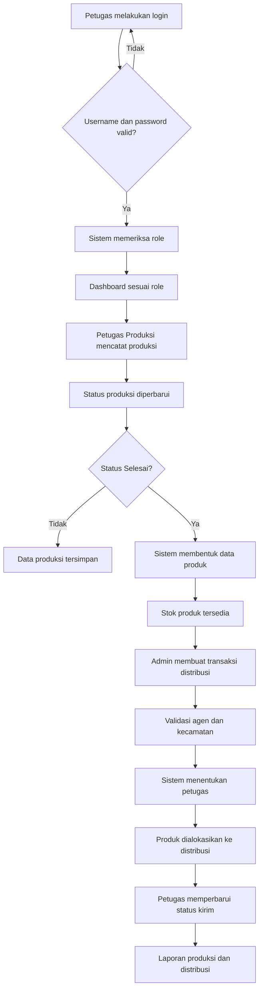
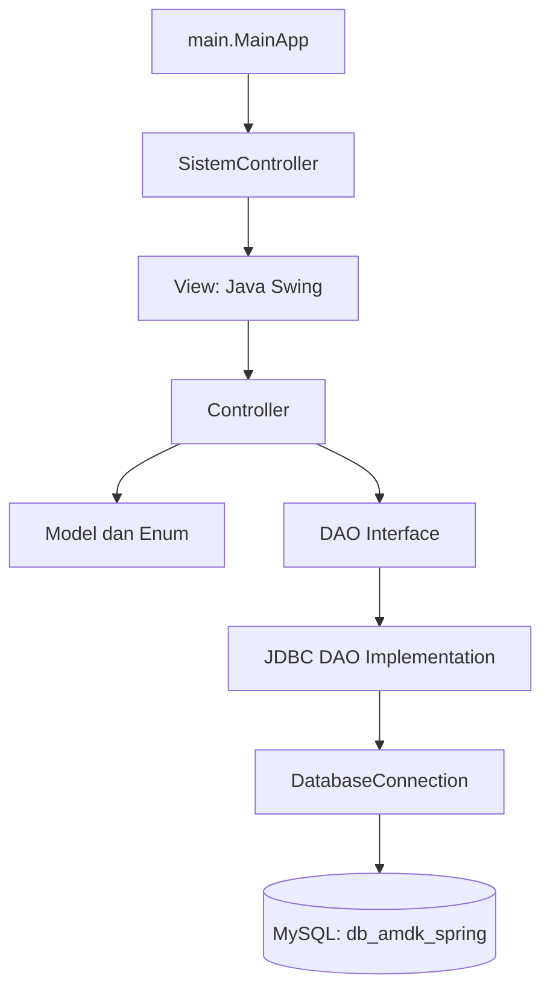

<p align="center">
  
</p>
<h1 align="center">PROJECT SPRING</h1>
<h3 align="center">Sistem Informasi Manajemen Produksi dan Distribusi Air Minum Kemasan</h3>
<p align="center">
  
  
  
  
  
</p>
<p align="center">
  <b>Integrasi pencatatan produksi, stok gudang, dan distribusi AMDK Spring dalam satu aplikasi desktop.</b>
</p>
---
Daftar Isi
Tentang Proyek
Anggota Kelompok
Latar Belakang
Identifikasi Masalah
Usulan Solusi
Keterkaitan dengan SDGs
Teknologi yang Digunakan
Fitur Sistem
Alur Proses Bisnis
Flowchart Sistem
Arsitektur Aplikasi
Arsitektur Database
Use Case dan Hak Akses
Penerapan Empat Pilar OOP
Struktur Package
Implementasi Query Database
Instalasi dan Konfigurasi
Menjalankan Aplikasi
Catatan Keamanan
Referensi
---
Tentang Proyek
Project SPRING merupakan aplikasi desktop untuk mendukung
pengelolaan operasional Air Minum Dalam Kemasan (AMDK). Sistem
menghubungkan pencatatan produksi, pengelolaan produk dan persediaan
gudang, pengelolaan agen, serta distribusi produk kepada agen mitra.
Aplikasi dibangun menggunakan Java Swing sebagai antarmuka, MySQL
sebagai basis data relasional, dan JDBC sebagai penghubung antara
aplikasi dengan basis data. Sistem menerapkan pembatasan hak akses
berdasarkan empat role, yaitu Admin, Petugas Produksi, Petugas Gudang,
dan Petugas Distribusi.
Ruang lingkup sistem berfokus pada manajemen informasi produksi, stok,
dan distribusi. Sistem tidak melakukan pengolahan air atau pengujian
laboratorium terhadap kualitas air.
Anggota Kelompok
No.	Nama	NIM
1	Muhammad Davi Aditya Pratama	2509116070
2	Aulia Ashylla Ananda Putri Hariawan	2509116076
3	Muhammad Arza Dwiarto Anugerah	2509116007
4	Dzulrrahim Oscar Aditya Akbar	2509116107
Program Studi: Sistem Informasi  
Fakultas: Teknik  
Universitas: Universitas Mulawarman  
Tahun: 2026
Latar Belakang
Operasional AMDK Spring melibatkan rangkaian kegiatan yang saling
berhubungan, mulai dari produksi, penyimpanan produk, pencatatan
persediaan, hingga pengiriman kepada agen. Setiap bagian membutuhkan
informasi yang akurat agar jumlah produk yang dihasilkan, tersedia di
gudang, dan dialokasikan untuk distribusi tetap sinkron.
Pencatatan yang tersebar atau masih bergantung pada proses manual dapat
memunculkan ketidaksesuaian data, keterlambatan pembaruan stok, dan
kesulitan dalam menelusuri riwayat transaksi. Salah satu isu yang
relevan adalah inventory record inaccuracy (IRI), yaitu perbedaan
antara jumlah persediaan yang tercatat dalam sistem dan jumlah fisik
yang tersedia. Best et al. (2022) menjelaskan bahwa ketidakakuratan
catatan persediaan dapat berkaitan dengan masalah ketersediaan barang
dan proses operasional ritel.
Karena itu, Project SPRING dikembangkan sebagai sistem informasi
terintegrasi. Sistem menyimpan data petugas, produksi, produk, agen, dan
distribusi dalam basis data relasional agar pencatatan serta pemantauan
operasional dapat dilakukan secara lebih konsisten.
Identifikasi Masalah
Pencatatan belum terintegrasi. Data produksi, persediaan, dan
distribusi memerlukan keterhubungan yang konsisten.
Ketepatan informasi stok perlu dijaga. Perbedaan antara catatan
sistem dan stok fisik dapat mengganggu keputusan pengiriman.
Risiko kesalahan input. Pencatatan dan rekapitulasi manual dapat
menimbulkan kesalahan, duplikasi, atau keterlambatan pembaruan.
Koordinasi antarbagian membutuhkan data yang sama. Petugas
produksi, gudang, dan distribusi memerlukan informasi sesuai
tanggung jawabnya.
Riwayat pengiriman perlu ditelusuri. Perusahaan perlu mengetahui
agen penerima, jenis dan jumlah produk, tanggal kirim, serta petugas
yang bertanggung jawab.
Hak akses perlu dibatasi. Setiap role hanya boleh menjalankan
fungsi yang sesuai dengan kewenangannya.
Usulan Solusi
Project SPRING menerapkan aplikasi desktop dengan basis data MySQL
terpusat. Solusi yang dikembangkan meliputi:
Menyimpan data operasional dalam tabel relasional dengan Primary Key
dan Foreign Key.
Memisahkan atribut umum dan atribut khusus melalui pola
supertype-subtype pada Petugas dan Produk.
Menggunakan tabel `detail_distribusi` untuk mencatat rincian pesanan
berdasarkan agen, transaksi, jenis produk, dan jumlah pesanan.
Menerapkan role-based access control pada lapisan controller.
Membentuk data produk secara otomatis ketika status produksi berubah
menjadi Selesai.
Menghitung stok tersedia dari produk yang belum dialokasikan ke
transaksi distribusi.
Mengalokasikan produk ke transaksi distribusi menggunakan transaksi
database.
Menentukan petugas gudang dan petugas distribusi berdasarkan
spesialisasi dan wilayah agen.
Menyediakan laporan produksi dan distribusi berdasarkan periode.
Solusi tersebut membantu menyusun pencatatan operasional dan menyediakan
riwayat transaksi yang dapat ditelusuri.
Keterkaitan dengan SDGs
SDG 6: Clean Water and Sanitation
Project SPRING mendukung pengelolaan informasi produksi dan penyaluran
produk air minum kemasan. Data volume produksi, ketersediaan produk, dan
pengiriman kepada agen dicatat secara terstruktur. Kontribusi sistem
berada pada aspek manajemen informasi dan distribusi, bukan pada
pengolahan maupun pengujian kualitas air.
Informasi lebih lanjut: United Nations SDG
6.
SDG 8: Decent Work and Economic Growth
Sistem membantu mengurangi pekerjaan pencatatan berulang dan memudahkan
koordinasi antarbagian. Data produksi, stok, agen, dan distribusi
tersimpan dalam satu basis data sehingga petugas dapat mengakses
informasi sesuai kewenangannya. Laporan operasional juga dapat digunakan
sebagai bahan evaluasi produktivitas kerja.
Informasi lebih lanjut: United Nations SDG
8.
Teknologi yang Digunakan
Teknologi	Peran dalam Proyek
Java 26	Bahasa pemrograman; `pom.xml` menetapkan compiler release 26
Java Swing	Membangun antarmuka aplikasi desktop
MySQL 8.0+	Menyimpan data operasional dalam basis data relasional
JDBC	Menghubungkan aplikasi Java dengan MySQL
MySQL Connector/J 9.3.0	Driver JDBC untuk MySQL
Apache Maven	Mengelola dependency dan proses build
NetBeans IDE	Lingkungan pengembangan dan editor form Swing
AbsoluteLayout	Mendukung tata letak komponen pada form Swing
Fitur Sistem
1. Login dan Manajemen Akun
Login menggunakan username dan password.
Sistem mengenali role pengguna setelah autentikasi.
Admin dapat menambah, melihat, mengubah, dan menghapus akun petugas.
Sistem membatasi akses fitur berdasarkan role.
2. Manajemen Agen
Menampilkan data agen.
Menambahkan, mengubah, dan menghapus data agen oleh Admin.
Memvalidasi nomor telepon dan data wajib.
Membatasi tampilan agen untuk Petugas Distribusi berdasarkan wilayah
tugas.
3. Manajemen Produksi
Menampilkan data produksi.
Menambahkan transaksi produksi.
Memperbarui data dan status produksi.
Menggunakan status Direncanakan, Diproses, Selesai, dan Dibatalkan.
Membatasi Petugas Produksi agar hanya mengelola transaksi miliknya.
Membentuk data produk secara otomatis ketika status berubah menjadi
Selesai.
Mencegah penghapusan transaksi produksi yang sudah menghasilkan
produk.
4. Manajemen Produk dan Stok Gudang
Sistem mendukung empat kategori produk:
Produk	Volume	Satuan Jual
Spring Botol 600 ml	600 ml	Dus
Spring Botol 1500 ml	1.500 ml	Dus
Spring Galon 5 L	5 liter	Galon
Spring Galon 19 L	19 liter	Galon
Produk botol menyimpan atribut `volume_ml` dan `pcs_per_dus`. Produk
galon menyimpan `volume_liter` dan `jenis_galon`, yaitu Isi Ulang atau
Sekali Pakai.
Stok tersedia dihitung berdasarkan jumlah baris produk pada tabel
subtype yang memiliki `id_distribusi IS NULL`.
5. Manajemen Distribusi
Admin membuat transaksi distribusi.
Satu transaksi dapat memuat rincian pesanan dari beberapa agen.
Sistem memvalidasi agen, kecamatan, jenis produk, dan jumlah pesanan.
Satu transaksi distribusi dibatasi untuk agen dalam kecamatan yang
sama.
Sistem menentukan petugas gudang dengan spesialisasi Outbound.
Sistem menentukan petugas distribusi berdasarkan wilayah tugas agen.
Sistem mengalokasikan produk yang tersedia ke transaksi.
Admin dapat mengubah tanggal kirim selama status masih Dalam
Pengiriman.
Admin dan petugas distribusi yang ditugaskan dapat memperbarui status
pengiriman.
Jika produk dikembalikan sesuai proses status, sistem dapat melepaskan
alokasi produk dari transaksi.
6. Laporan Operasional
Sistem menyediakan laporan produksi dan distribusi, termasuk:
Jumlah transaksi produksi.
Jumlah produksi berdasarkan status.
Jumlah produk yang dihasilkan.
Jumlah transaksi distribusi.
Distribusi Dalam Pengiriman, Terkirim, dan Tidak Terkirim.
Laporan berdasarkan rentang tanggal.
Laporan berdasarkan periode mingguan, bulanan, dan tahunan.
Alur Proses Bisnis

Flowchart Sistem
Flowchart berikut mengikuti urutan gambar pada laporan Project Akhir.
Gambar yang dikirim berulang tidak ditampilkan dua kali.
1. Flowchart Login
Menjelaskan autentikasi username dan password, validasi ke basis data,
pemeriksaan role, dan pengarahan pengguna ke dashboard sesuai
kewenangannya.
<p align="center">
  
</p>
2. Flowchart Menu Petugas Produksi dan Gudang
Menjelaskan navigasi Petugas Produksi untuk mengelola produksi dan
melihat laporan. Petugas Gudang dapat melihat data agen, produksi,
distribusi, memperbarui data produk, serta mengakses laporan.
<p align="center">
  
</p>
3. Flowchart Menu Petugas Distribusi dan Admin
Menjelaskan navigasi Petugas Distribusi untuk melihat dan mengelola
distribusi serta laporan. Admin memiliki akses ke pengelolaan akun,
agen, produksi, produk, distribusi, dan laporan.
<p align="center">
  
</p>
4. Flowchart Pengelolaan Data Produksi
Menjelaskan proses membaca data produksi, menampilkan dashboard,
menambah data, memperbarui data atau status, menghapus data sesuai hak
akses, dan menyegarkan tampilan setelah transaksi.
<p align="center">
  
</p>
5. Flowchart Pengelolaan Data Distribusi
Menjelaskan pembacaan data distribusi, pembuatan transaksi, pembaruan
status pengiriman, penghapusan transaksi oleh Admin, dan pembacaan ulang
data.
<p align="center">
  
</p>
6. Flowchart Pengelolaan Data Agen
Menjelaskan proses menampilkan, menambah, memperbarui, dan menghapus
data agen. Sistem memberikan notifikasi setelah proses penyimpanan dan
pembaruan berhasil.
<p align="center">
  
</p>
7. Flowchart Pengelolaan Data Produk
Menjelaskan proses menampilkan data produk, menambah produk, memperbarui
atribut produk, dan menghapus produk sesuai ketentuan relasi database.
<p align="center">
  
</p>
8. Flowchart Pengelolaan Data Akun
Menjelaskan proses membaca data akun, menambah akun, memperbarui akun,
menghapus akun, dan menyegarkan tampilan dashboard akun.
<p align="center">
  
</p>
Arsitektur Aplikasi
Aplikasi menggunakan pemisahan tanggung jawab antara antarmuka pengguna,
logika bisnis, model, dan akses data.

Lapisan	Package	Tanggung Jawab
Entry Point	`main`	Memulai aplikasi melalui `MainApp`
Configuration	`config`	Mengatur koneksi ke MySQL
Model	`model`	Merepresentasikan entitas, aturan data, dan perilaku objek
Model Type	`model.type`	Menyediakan enum role, jenis produk, dan status
Controller	`controller`	Mengelola proses bisnis, validasi, sesi, dan hak akses
DAO	`dao`	Mendefinisikan operasi data dan implementasi JDBC
View	`view`	Menampilkan form dan dashboard Java Swing
View Panel	`view.panel`	Menyediakan panel pengelolaan data
Pola tersebut menggabungkan pemisahan tanggung jawab yang terinspirasi
dari MVC dengan Data Access Object (DAO) untuk mengisolasi operasi
basis data dari logika bisnis.
Arsitektur Database
Basis data menggunakan MySQL dengan nama `db_amdk_spring`. Implementasi
fisik terdiri atas 12 tabel.
Logical ERD
<p align="center">
  
</p>
Relational ERD
<p align="center">
  
</p>
Use Case Diagram
<p align="center">
  
</p>
Entitas Database
Tabel	Fungsi
`petugas`	Menyimpan akun dan data umum petugas
`petugas_admin`	Menyimpan spesialisasi Admin
`petugas_produksi`	Menyimpan spesialisasi proses produksi
`petugas_gudang`	Menyimpan spesialisasi tugas gudang
`petugas_distribusi`	Menyimpan wilayah tugas distribusi
`produksi`	Menyimpan transaksi produksi
`produk`	Menyimpan data umum produk
`produk_botol`	Menyimpan atribut khusus produk botol dan alokasi distribusi
`produk_galon`	Menyimpan atribut khusus produk galon dan alokasi distribusi
`agen`	Menyimpan data agen mitra
`distribusi`	Menyimpan transaksi pengiriman dan petugas penanggung jawab
`detail_distribusi`	Menyimpan rincian jenis dan jumlah pesanan untuk setiap agen dalam transaksi
Relasi Penting
Petugas dan subtype petugas (1:1). `petugas_admin`,
`petugas_produksi`, `petugas_gudang`, dan `petugas_distribusi`
menggunakan `id_petugas` sebagai Primary Key sekaligus Foreign Key
ke tabel `petugas`.
Produk dan subtype produk (1:1). `produk_botol` dan
`produk_galon` menggunakan `id_produk` sebagai Primary Key sekaligus
Foreign Key ke tabel `produk`.
Petugas Produksi dan Produksi (1:N). Satu petugas produksi dapat
mencatat banyak transaksi produksi.
Produksi dan Produk (1:N). Satu transaksi produksi dapat
menghasilkan banyak item produk.
Petugas Gudang dan Distribusi (1:N). Satu petugas gudang dapat
tercatat pada banyak transaksi distribusi.
Petugas Distribusi dan Distribusi (1:N). Satu petugas distribusi
dapat menangani banyak transaksi pengiriman.
Distribusi dan Detail Distribusi (1:N). Satu transaksi
distribusi dapat memuat beberapa rincian pesanan.
Agen dan Detail Distribusi (1:N). Satu agen dapat muncul dalam
banyak rincian pesanan pada transaksi yang berbeda.
Distribusi dan produk subtype (1:N). Tabel `produk_botol` dan
`produk_galon` memiliki `id_distribusi` yang dapat bernilai `NULL`.
Nilai tersebut digunakan untuk menandai apakah item produk telah
dialokasikan ke suatu transaksi distribusi.
Catatan implementasi: Tabel `detail_distribusi` menyimpan agen,
transaksi, jenis produk, jumlah pesanan, dan tanggal pesanan. Sementara
itu, alokasi item produk secara fisik dicatat melalui kolom
`id_distribusi` pada tabel `produk_botol` dan `produk_galon`. Dengan
demikian, data pesanan agen dan alokasi stok produk memiliki fungsi yang
saling melengkapi.
Constraint dan Integritas Data
Primary Key pada setiap tabel utama.
Foreign Key untuk menjaga keterhubungan antarentitas.
Unique Key pada kombinasi `id_agen`, `id_distribusi`, dan
`jenis_produk` di `detail_distribusi`.
Enum untuk membatasi nilai role, status produksi, status pengiriman,
dan jenis produk.
`ON DELETE SET NULL` pada Foreign Key `id_distribusi` di tabel subtype
produk agar alokasi dapat dilepas ketika transaksi distribusi dihapus.
Use Case dan Hak Akses
Sistem memiliki empat aktor utama: Admin, Petugas Produksi, Petugas
Gudang, dan Petugas Distribusi. Hak akses diterapkan melalui pemeriksaan
role pada controller.
Fitur	Admin	Produksi	Gudang	Distribusi
Login dan Logout	✓	✓	✓	✓
Kelola akun petugas	CRUD	—	—	—
Lihat data agen	✓	—	✓	✓ sesuai wilayah
Tambah, ubah, hapus agen	CRUD	—	—	—
Lihat data produk	✓	✓	✓	✓
Ubah data produk	✓	—	✓	—
Hapus data produk	✓	—	—	—
Kelola data produksi	CRUD	Tambah dan ubah milik sendiri	Lihat	—
Lihat data distribusi	✓	—	✓	✓ sesuai penugasan
Buat distribusi dan ubah tanggal kirim	✓	—	—	—
Ubah status pengiriman	✓	—	—	✓ sesuai penugasan
Hapus transaksi distribusi	✓	—	—	—
Lihat laporan produksi	✓	✓	✓	✓
Lihat laporan distribusi	✓	✓	✓	✓
Keterangan:
`CRUD`: Create, Read, Update, Delete.
Petugas Produksi hanya dapat mengelola transaksi produksi atas namanya
sendiri.
Petugas Distribusi hanya dapat melihat dan memperbarui transaksi yang
menjadi penugasannya.
Petugas Distribusi hanya dapat melihat agen yang berada dalam wilayah
tugasnya.
Petugas Gudang dapat melihat data agen, produksi, dan distribusi serta
memperbarui data produk.
Hak akses diperiksa pada controller sehingga tidak hanya bergantung
pada visibilitas menu di GUI.
Penerapan Empat Pilar OOP
Project SPRING menerapkan empat pilar utama Object-Oriented
Programming (OOP), yaitu Encapsulation, Inheritance, Abstraction, dan
Polymorphism. Bukti implementasi berikut menggunakan screenshot source
code yang dikirim oleh tim.
1. Encapsulation (Enkapsulasi)
Enkapsulasi melindungi atribut objek dari akses langsung. Pada kelas
`Petugas`, atribut penting menggunakan modifier `private`. Akses dan
perubahan data dilakukan melalui method getter dan setter.
Contoh struktur atribut pada `Petugas.java`:
``` java
public abstract class Petugas implements AksesMenu {
    private final String idPetugas;
    private String username;
    private String passwordHash;
    private final Role role;
    private String nama;
}
```
Setter juga menjalankan validasi sebelum menyimpan nilai. Contohnya,
`setUsername()` mengubah username menjadi huruf kecil dan membatasi
panjangnya antara 3 sampai 30 karakter. `setNama()` membatasi nama
petugas maksimal 100 karakter.
Bukti kode:
<p align="center">
  
  <br>
  <em>Gambar 1. Atribut private pada kelas Petugas.</em>
</p>
<p align="center">
  
  <br>
  <em>Gambar 2. Getter dan setter dengan validasi pada kelas Petugas.</em>
</p>
Penerapan ini menjaga konsistensi nilai atribut dan memastikan perubahan
data melewati aturan yang ditetapkan kelas.
2. Inheritance (Pewarisan)
Inheritance memungkinkan kelas turunan menggunakan atribut dan method
dari kelas induk. Project SPRING menerapkan pewarisan pada hierarki
petugas dan produk.
Contoh pada `PetugasAdmin.java`:
``` java
public final class PetugasAdmin extends Petugas {
    private String spesialisasiAdmin;

    public PetugasAdmin(
            String id,
            String username,
            String nama,
            String hash,
            String spesialisasiAdmin) {
        super(id, username, nama, hash, Role.Admin);
        setSpesialisasiAdmin(spesialisasiAdmin);
    }
}
```
Kelas `PetugasAdmin` mewarisi atribut dan perilaku umum dari `Petugas`.
Pemanggilan `super(...)` menginisialisasi bagian objek yang berasal dari
kelas induk, sedangkan `spesialisasiAdmin` menyimpan atribut khusus
Admin.
Pola serupa diterapkan pada:
`PetugasProduksi extends Petugas`
`PetugasGudang extends Petugas`
`PetugasDistribusi extends Petugas`
`ProdukBotol extends Produk`
`ProdukGalon extends Produk`
Bukti kode:
<p align="center">
  
  <br>
  <em>Gambar 3. Kelas PetugasAdmin mewarisi kelas Petugas.</em>
</p>
Pewarisan mengurangi pengulangan atribut umum dan memudahkan
pengembangan jenis petugas maupun produk.
3. Abstraction (Abstraksi)
Abstraksi menetapkan perilaku umum dan menyembunyikan detail
implementasi dari bagian yang menggunakan objek.
Project SPRING menerapkan abstraksi melalui kelas abstrak `Produk`:
``` java
public abstract class Produk {
    private final String idProduk;
    private String namaProduk;
    private BigDecimal hargaSatuan;
    private final String idProduksi;
    private String idDistribusi;

    public abstract String getDeskripsiKemasan();
    public abstract JenisProduk getJenisProduk();
    public abstract String getSatuanJual();
}
```
Kelas `Produk` menetapkan tiga perilaku yang harus dimiliki seluruh
jenis produk. Implementasinya disesuaikan dengan karakteristik produk
botol dan galon.
Abstraksi juga diterapkan melalui interface `CrudDAO<T>`:
``` java
public interface CrudDAO<T> {
    void insert(T objek);
    List<T> findAll();
    T findById(String id);
    void update(T objek);
    void delete(String id);
}
```
Interface tersebut mendefinisikan kontrak operasi CRUD tanpa menentukan
detail query SQL. Implementasi JDBC berada pada kelas DAO konkret,
seperti `AgenJdbcDAO`, `ProdukJdbcDAO`, dan `ProduksiJdbcDAO`.
Bukti kode:
<p align="center">
  
  <br>
  <em>Gambar 4. Kelas Produk sebagai abstract class.</em>
</p>
<p align="center">
  
  <br>
  <em>Gambar 5. Method abstrak yang wajib diimplementasikan subclass.</em>
</p>
<p align="center">
  
  <br>
  <em>Gambar 6. Interface CrudDAO sebagai kontrak akses data.</em>
</p>
Penerapan abstraksi memisahkan definisi perilaku dari detail
implementasi. Controller dapat menggunakan kontrak DAO tanpa bergantung
langsung pada cara query database dijalankan.
4. Polymorphism (Polimorfisme)
Polimorfisme memungkinkan method dengan nama dan kontrak yang sama
menghasilkan perilaku berbeda berdasarkan objek atau parameter yang
digunakan.
A. Method Overriding
Overriding terjadi ketika kelas turunan menyediakan implementasi method
yang diwarisi dari kelas induk. Pada Project SPRING, `ProdukBotol` dan
`ProdukGalon` mengimplementasikan ulang tiga method abstrak dari
`Produk`.
Pada `ProdukBotol`:
`getDeskripsiKemasan()` menghasilkan informasi volume dan jumlah botol
per dus.
`getJenisProduk()` membedakan produk botol 600 ml dan 1500 ml.
`getSatuanJual()` menghasilkan satuan `DUS`.
Pada `ProdukGalon`:
`getDeskripsiKemasan()` menghasilkan informasi volume dan jenis galon.
`getJenisProduk()` membedakan galon 5 L dan 19 L.
`getSatuanJual()` menghasilkan satuan `GALON`.
Bukti kode:
<p align="center">
  
  <br>
  <em>Gambar 7. Implementasi overriding pada ProdukBotol.</em>
</p>
<p align="center">
  
  <br>
  <em>Gambar 8. Implementasi overriding pada ProdukGalon.</em>
</p>
Kedua subclass menggunakan nama method yang sama, tetapi menghasilkan
deskripsi, jenis produk, dan satuan jual yang berbeda sesuai
karakteristik kemasannya.
B. Method Overloading
Overloading terjadi ketika satu kelas memiliki beberapa method dengan
nama sama, tetapi daftar parameter berbeda.
Project SPRING menerapkannya pada `AgenController`:
``` java
public Agen cariAgen(String id) {
    // Mencari satu agen berdasarkan ID.
}

public List<Agen> cariAgen(String nama, String kecamatan) {
    // Mencari daftar agen berdasarkan nama dan kecamatan.
}
```
Method pertama mencari satu agen menggunakan ID. Method kedua mencari
beberapa agen berdasarkan nama dan kecamatan.
Bukti kode:
<p align="center">
  
  <br>
  <em>Gambar 9. Method cariAgen dengan parameter berbeda pada AgenController.</em>
</p>
Penerapan overloading memudahkan pemanggil menggunakan satu nama method
untuk kebutuhan pencarian yang berbeda.
Struktur Package
Struktur utama source code berdasarkan arsip proyek:
``` text
spring/
├── README.md
├── pom.xml
├── assets/
│   ├── erd-logical.png
│   ├── erd-relational.png
│   ├── use-case.png
│   ├── oop/
│   └── flowchart/
├── database/
│   ├── db_amdk_spring.sql
│   └── database.properties.example
└── src/
    └── main/
        ├── java/
        │   ├── config/
        │   │   └── DatabaseConnection.java
        │   ├── controller/
        │   │   ├── AkunController.java
        │   │   ├── AgenController.java
        │   │   ├── DistribusiController.java
        │   │   ├── LaporanController.java
        │   │   ├── ProdukController.java
        │   │   ├── ProduksiController.java
        │   │   ├── SistemController.java
        │   │   └── ValidasiInput.java
        │   ├── dao/
        │   │   ├── CrudDAO.java
        │   │   ├── AgenDAO.java
        │   │   ├── AgenJdbcDAO.java
        │   │   ├── DetailDistribusiDAO.java
        │   │   ├── DistribusiDAO.java
        │   │   ├── DistribusiJdbcDAO.java
        │   │   ├── LaporanDAO.java
        │   │   ├── LaporanJdbcDAO.java
        │   │   ├── PetugasDAO.java
        │   │   ├── PetugasJdbcDAO.java
        │   │   ├── ProdukDAO.java
        │   │   ├── ProdukJdbcDAO.java
        │   │   ├── ProduksiDAO.java
        │   │   └── ProduksiJdbcDAO.java
        │   ├── main/
        │   │   └── MainApp.java
        │   ├── model/
        │   │   ├── Agen.java
        │   │   ├── AksesMenu.java
        │   │   ├── DetailDistribusi.java
        │   │   ├── Distribusi.java
        │   │   ├── Petugas.java
        │   │   ├── PetugasAdmin.java
        │   │   ├── PetugasDistribusi.java
        │   │   ├── PetugasGudang.java
        │   │   ├── PetugasProduksi.java
        │   │   ├── Produk.java
        │   │   ├── ProdukBotol.java
        │   │   ├── ProdukGalon.java
        │   │   ├── Produksi.java
        │   │   └── type/
        │   │       ├── JenisProduk.java
        │   │       ├── Role.java
        │   │       ├── StatusKirim.java
        │   │       └── StatusProduksi.java
        │   └── view/
        │       ├── Form Java Swing (*.java, *.form)
        │       ├── ViewHelper.java
        │       └── panel/
        │           ├── AgenPanel.java
        │           ├── AkunPanel.java
        │           ├── DistribusiPanel.java
        │           ├── LaporanPanel.java
        │           ├── ProdukPanel.java
        │           ├── ProduksiPanel.java
        │           └── StokPanel.java
        └── resources/
            └── images/
                ├── Spring Logo with Swirl Emblem.png
                ├── Spring Logo with Swirl Emblem (2).png
                └── pabrik 2.png
```
Implementasi Query Database
Laporan Project Akhir membahas beberapa kelompok perintah SQL. File
`database/db_amdk_spring.sql` yang disertakan pada repository berisi
struktur tabel, constraint, indeks, dan data contoh.
Kategori	Penerapan
DDL	`CREATE TABLE`, `ALTER TABLE`, Primary Key, Foreign Key, dan indeks
DML	`INSERT` untuk data contoh; operasi `INSERT`, `UPDATE`, dan `DELETE` melalui DAO
SELECT lanjutan	Filter, pencarian, agregasi, dan pengambilan data untuk dashboard/laporan
JOIN	Penggabungan tabel petugas, produksi, produk, agen, dan distribusi
DCL	Materi pengaturan hak akses database yang dibahas pada laporan praktikum
TCL	Penggunaan transaksi untuk menjaga konsistensi operasi yang melibatkan beberapa perubahan data
Pada source code, query menggunakan `PreparedStatement`. Proses
distribusi dan perubahan status tertentu menggunakan
`setAutoCommit(false)`, `commit()`, dan `rollback()` agar perubahan yang
saling terkait dapat disimpan atau dibatalkan sebagai satu kesatuan.
Instalasi dan Konfigurasi
Persyaratan
Siapkan perangkat lunak berikut:
JDK 26, sesuai `maven.compiler.release` pada `pom.xml`.
Apache Maven.
MySQL Server 8.0 atau lebih baru.
NetBeans IDE, disarankan untuk membuka form Java Swing.
Git, jika mengambil source code dari GitHub.
1. Clone Repository
Ganti `<URL-REPOSITORY>` dengan alamat repository Project SPRING.
``` bash
git clone <URL-REPOSITORY>
cd <FOLDER-REPOSITORY>
```
Pastikan direktori aktif berisi `pom.xml`, `README.md`, folder
`assets/`, dan folder `database/`. Jika source code masih berada di
dalam subfolder `spring/`, masuk ke subfolder tersebut sebelum
menjalankan perintah Maven.
2. Buat Database
File dump SQL yang disertakan berada di:
``` text
database/db_amdk_spring.sql
```
File tersebut berisi `CREATE TABLE`, indeks, Foreign Key, dan data
contoh. Dump tidak menjalankan `CREATE DATABASE` atau `USE`, sehingga
database perlu dibuat terlebih dahulu.
Jalankan perintah berikut pada MySQL:
``` sql
CREATE DATABASE db_amdk_spring
CHARACTER SET utf8mb4
COLLATE utf8mb4_0900_ai_ci;
```
Import file SQL melalui terminal:
``` bash
mysql -u root -p db_amdk_spring < database/db_amdk_spring.sql
```
Atau melalui phpMyAdmin:
Buka phpMyAdmin.
Buat database bernama `db_amdk_spring`.
Pilih database tersebut.
Buka menu Import.
Pilih file `database/db_amdk_spring.sql`.
Jalankan proses import.
3. Konfigurasi Koneksi Database
`DatabaseConnection.java` membaca konfigurasi dengan urutan prioritas:
Environment variable.
File `database.properties` pada classpath.
Nilai default aplikasi.
Salin file contoh:
``` text
database/database.properties.example
```
ke:
``` text
src/main/resources/database.properties
```
Sesuaikan isinya:
``` properties
db.url=jdbc:mysql://localhost:3306/db_amdk_spring?useSSL=false&serverTimezone=Asia/Jakarta&allowPublicKeyRetrieval=true
db.username=root
db.password=PASSWORD_MYSQL_KAMU
```
Alternatifnya, gunakan environment variable:
Variabel	Contoh
`SPRING_DB_URL`	`jdbc:mysql://localhost:3306/db_amdk_spring?useSSL=false&serverTimezone=Asia/Jakarta&allowPublicKeyRetrieval=true`
`SPRING_DB_USER`	`root`
`SPRING_DB_PASSWORD`	Password MySQL lokal
Jangan mengunggah password database ke repository publik.
Menjalankan Aplikasi
Melalui NetBeans
Buka folder proyek `spring` di NetBeans.
Tunggu sampai dependency Maven selesai dimuat.
Pastikan MySQL Server aktif.
Pastikan database `db_amdk_spring` sudah di-import.
Pastikan file `database.properties` sudah dikonfigurasi.
Buka `src/main/java/main/MainApp.java`.
Jalankan class `MainApp`.
Melalui Maven
Build project:
``` bash
mvn clean package
```
Menjalankan aplikasi menggunakan Maven Exec Plugin:
``` bash
mvn org.codehaus.mojo:exec-maven-plugin:3.5.0:java -Dexec.mainClass=main.MainApp
```
Catatan konfigurasi: Pada arsip source code yang diperiksa,
`pom.xml` masih mengatur `exec.mainClass` sebagai `spring.MainApp`,
sedangkan class utama berada pada package `main` dengan nama lengkap
`main.MainApp`. Jika menggunakan konfigurasi entry point dari `pom.xml`,
ubah menjadi:
``` xml
<exec.mainClass>main.MainApp</exec.mainClass>
```
Catatan Keamanan
File SQL berisi data contoh. Nilai password contoh seperti
`pass_hash_01` bukan password untuk penggunaan nyata.
Controller saat ini menggunakan SHA-256 untuk membuat hash password
baru. Untuk penggunaan produksi, pertimbangkan algoritma khusus
penyimpanan password seperti BCrypt atau Argon2.
Jangan menyimpan password database, password pengguna asli, atau
kredensial pribadi pada repository publik.
Folder `target/` berisi hasil kompilasi dan tidak perlu diunggah ke
GitHub. Tambahkan `target/` ke `.gitignore`.
Jangan unggah `database.properties` yang berisi password. Unggah hanya
file contoh tanpa kredensial.
Referensi
Best, J., Glock, C. H., Grosse, E. H., Rekik, Y., & Syntetos, A.
(2022). On the causes of positive inventory discrepancies in retail
stores. International Journal of Physical Distribution & Logistics
Management, 52(5–6), 414–430.
[[[https://doi.org/10.1108/IJPDLM-07-2021-0291\(https://doi.org/10.1108/IJPDLM-07-2021-0291)\(https://doi.org/10.1108/IJPDLM-07-2021-0291\(https://doi.org/10.1108/IJPDLM-07-2021-0291))](https://doi.org/10.1108/IJPDLM-07-2021-0291\(https://doi.org/10.1108/IJPDLM-07-2021-0291)](https://doi.org/10.1108/IJPDLM-07-2021-0291](https://doi.org/10.1108/IJPDLM-07-2021-0291)))
Bernal, M. C., & Molina, Y. (2022). A test model for database
architectures: An assessment for job search engine systems. Journal
of Applied Research and Technology, 20(3), 306–319.
[[[https://doi.org/10.22201/icat.24486736e.2022.20.3.1169\(https://doi.org/10.22201/icat.24486736e.2022.20.3.1169)\(https://doi.org/10.22201/icat.24486736e.2022.20.3.1169\(https://doi.org/10.22201/icat.24486736e.2022.20.3.1169))](https://doi.org/10.22201/icat.24486736e.2022.20.3.1169\(https://doi.org/10.22201/icat.24486736e.2022.20.3.1169)](https://doi.org/10.22201/icat.24486736e.2022.20.3.1169](https://doi.org/10.22201/icat.24486736e.2022.20.3.1169)))
Fandol, Z. W., Zuhrufillah, I., & Sumantri, R. B. B. (2023). Rancang
Bangun Sistem Informasi Manajemen Ketersediaan Obat Pada Apotek XYZ
Berbasis Web. Prosiding Seminar Nasional Penelitian dan Pengabdian
kepada Masyarakat, 1(1), 293–298.
[[[https://doi.org/10.24002/senapas.v1i1.7370\(https://doi.org/10.24002/senapas.v1i1.7370)\(https://doi.org/10.24002/senapas.v1i1.7370\(https://doi.org/10.24002/senapas.v1i1.7370))](https://doi.org/10.24002/senapas.v1i1.7370\(https://doi.org/10.24002/senapas.v1i1.7370)](https://doi.org/10.24002/senapas.v1i1.7370](https://doi.org/10.24002/senapas.v1i1.7370)))
Jamaludin, M. (2021). Desain Sistem Informasi Manajemen Rantai Pasok
pada PT “ABCD” Bandung Jawa Barat Indonesia. Jurnal Administrasi
Bisnis, 10(2), 143–154.
[[[https://doi.org/10.14710/jab.v10i2.36302\(https://doi.org/10.14710/jab.v10i2.36302)\(https://doi.org/10.14710/jab.v10i2.36302\(https://doi.org/10.14710/jab.v10i2.36302))](https://doi.org/10.14710/jab.v10i2.36302\(https://doi.org/10.14710/jab.v10i2.36302)](https://doi.org/10.14710/jab.v10i2.36302](https://doi.org/10.14710/jab.v10i2.36302)))
---
<p align="center">
  <b>PROJECT SPRING</b><br>
  Sistem Informasi Manajemen Produksi dan Distribusi Air Minum Kemasan<br>
  Program Studi Sistem Informasi · Universitas Mulawarman · 2026
</p>
