<p align="center">
  
</p>

<h1 align="center">PROJECT SPRING</h1>

<p align="center">
  <b>SISTEM INFORMASI MANAJEMEN PRODUKSI DAN DISTRIBUSI AIR MINUM KEMASAN</b>
</p>

<p align="center">
  <b>SDG 6: Clean Water and Sanitation</b><br>
  <b>SDG 8: Decent Work and Economic Growth</b>
</p>

<p align="center">
  
  
  
  
</p>

---

## 👥 Anggota Kelompok

| No. | Nama | NIM |
|---|---|---|
| 1 | Muhammad Davi Aditya Pratama | 2509116070 |
| 2 | Aulia Ashylla Ananda Putri Hariawan | 2509116076 |
| 3 | Muhammad Arza Dwiarto Anugerah | 2509116007 |
| 4 | Dzulrrahim Oscar Aditya Akbar | 2509116107 |

---

## 📌 Deskripsi Singkat Program

**Project SPRING** merupakan aplikasi Sistem Informasi Manajemen Produksi dan Distribusi Air Minum Dalam Kemasan (AMDK) yang dikembangkan menggunakan bahasa pemrograman Java.

Sistem ini dirancang untuk membantu pengelolaan aktivitas operasional perusahaan, mulai dari pencatatan produksi, pengelolaan produk, pendataan agen, hingga proses distribusi air minum kemasan.

Aplikasi menggunakan Java Swing sebagai antarmuka pengguna dan MySQL sebagai sistem penyimpanan data. Sistem menerapkan pembagian hak akses berdasarkan empat role, yaitu Admin, Petugas Produksi, Petugas Gudang, dan Petugas Distribusi.

Dengan adanya sistem ini, pengelolaan data menjadi lebih terstruktur, terintegrasi, dan mudah dipantau.

## 🎯 Latar Belakang dan Identifikasi Masalah

Pengelolaan produksi dan distribusi AMDK membutuhkan pencatatan data yang akurat agar seluruh aktivitas operasional dapat berjalan dengan baik.

Beberapa permasalahan yang menjadi dasar pengembangan Project SPRING meliputi:

1. Pencatatan produksi dan distribusi berpotensi menimbulkan kesalahan data.
2. Kesulitan memantau jumlah produk yang dihasilkan dan didistribusikan.
3. Pengelolaan data agen dan transaksi distribusi membutuhkan sistem yang terintegrasi.
4. Proses pencarian dan penyusunan laporan operasional kurang efisien.
5. Perlunya pembatasan akses pengguna berdasarkan tugas dan tanggung jawab masing-masing.

### 💡 Usulan Solusi

Project SPRING dikembangkan sebagai solusi digital melalui sistem informasi berbasis Java dan database MySQL.

Sistem menyediakan fitur pengelolaan data menggunakan operasi CRUD (Create, Read, Update, Delete), pencatatan aktivitas produksi dan distribusi, pengelolaan agen, serta pembagian hak akses berdasarkan role pengguna.

---

## 🌍 Sustainable Development Goals (SDGs)

Pengembangan Project SPRING mendukung dua tujuan pembangunan berkelanjutan.

### 1. SDG 6: Clean Water and Sanitation  


Sistem mendukung pengelolaan informasi produksi dan distribusi air minum kemasan secara terstruktur. Pencatatan volume produksi dan penyaluran produk membantu perusahaan memantau proses distribusi serta mengelola informasi operasional dengan lebih baik.

### 2. SDG 8: Decent Work and Economic Growth  


Digitalisasi pencatatan membantu mengurangi pekerjaan administratif manual, meminimalkan kesalahan manusia, dan meningkatkan efisiensi pengelolaan data. Pembagian hak akses juga membantu setiap petugas menjalankan tugas sesuai tanggung jawabnya.

---

## 🛠️ Tech Stack

| Teknologi | Keterangan |
|---|---|
| Java | Bahasa pemrograman utama |
| Java Swing | Pembuatan Graphical User Interface (GUI) |
| MySQL | Relational Database Management System |
| JDBC | Koneksi aplikasi Java dengan database |
| Apache Maven | Manajemen dependency dan build project |
| NetBeans IDE | Lingkungan pengembangan aplikasi |
| MySQL Connector/J | Driver koneksi Java ke MySQL |

---

## ⚙️ Fitur Utama Sistem

| Fitur | Deskripsi |
|---|---|
| Login | Autentikasi pengguna berdasarkan username dan password |
| Manajemen Akun | Pengelolaan akun dan role petugas |
| Data Agen | Pengelolaan informasi agen perusahaan |
| Data Produk | Pengelolaan produk botol dan galon |
| Data Produksi | Pencatatan dan pengelolaan aktivitas produksi |
| Data Distribusi | Pencatatan dan pembaruan status pengiriman |
| Data Gudang | Pemantauan informasi produk dan distribusi |
| Laporan | Menampilkan laporan produksi dan distribusi |

---

# 📊 FLOWCHART PROGRAM

Flowchart menggambarkan alur kerja sistem mulai dari autentikasi pengguna hingga pengelolaan data berdasarkan masing-masing role.

<details>
<summary><b>🔐 1. Flowchart Login dan Pembagian Role</b></summary>

<p align="center">
  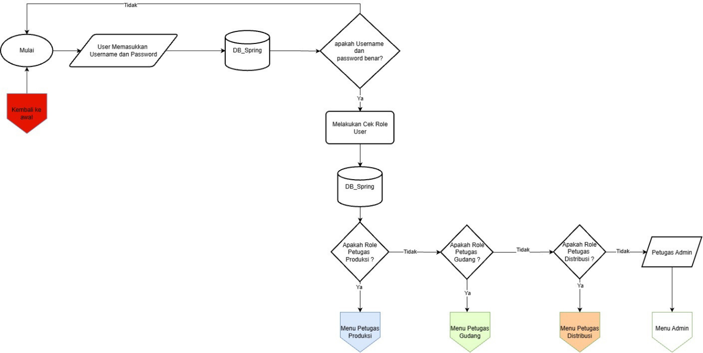
</p>

Flowchart ini menjelaskan proses autentikasi pengguna. Sistem memvalidasi username dan password melalui database. Setelah berhasil, sistem memeriksa role dan mengarahkan pengguna ke dashboard yang sesuai.

</details>

<details>
<summary><b>👥 2. Flowchart Menu Petugas Produksi dan Gudang</b></summary>

<p align="center">
  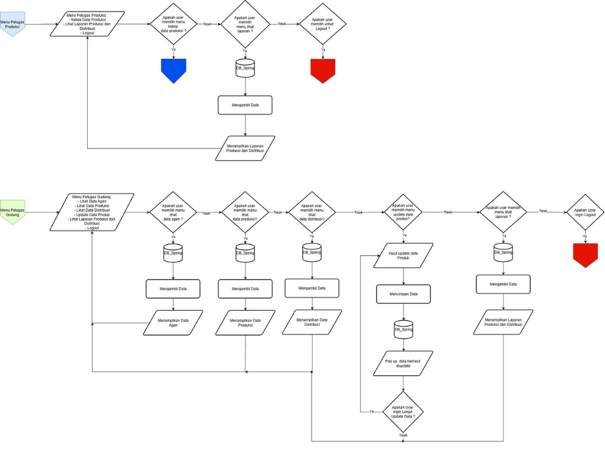
</p>

Flowchart ini menjelaskan navigasi menu Petugas Produksi dan Petugas Gudang. Petugas Produksi dapat mengelola data produksi dan melihat laporan. Petugas Gudang dapat melihat data agen, produksi, distribusi, memperbarui data produk, dan melihat laporan.

</details>

<details>
<summary><b>📋 3. Flowchart Menu Petugas Distribusi dan Admin</b></summary>

<p align="center">
  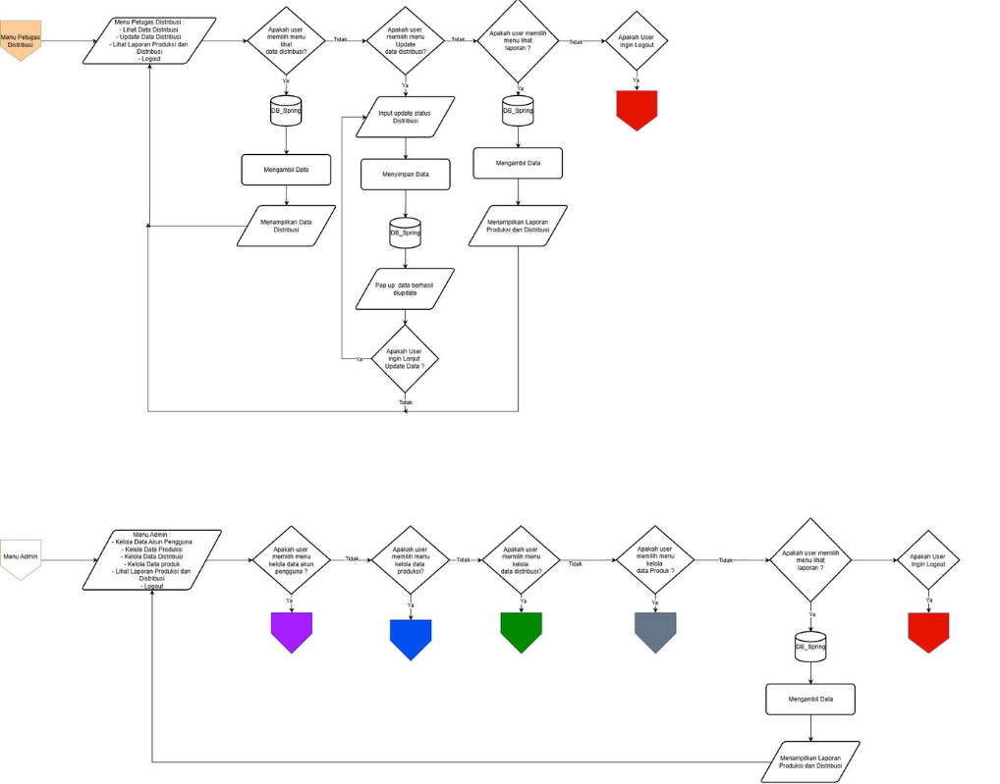
</p>

Flowchart ini menggambarkan navigasi utama Petugas Distribusi dan Admin. Admin memiliki akses ke pengelolaan akun, produksi, distribusi, produk, dan laporan. Petugas Distribusi berfokus pada pengelolaan informasi distribusi dan laporan.

</details>

<details>
<summary><b>🏭 4. Flowchart Pengelolaan Data Produksi</b></summary>

<p align="center">
  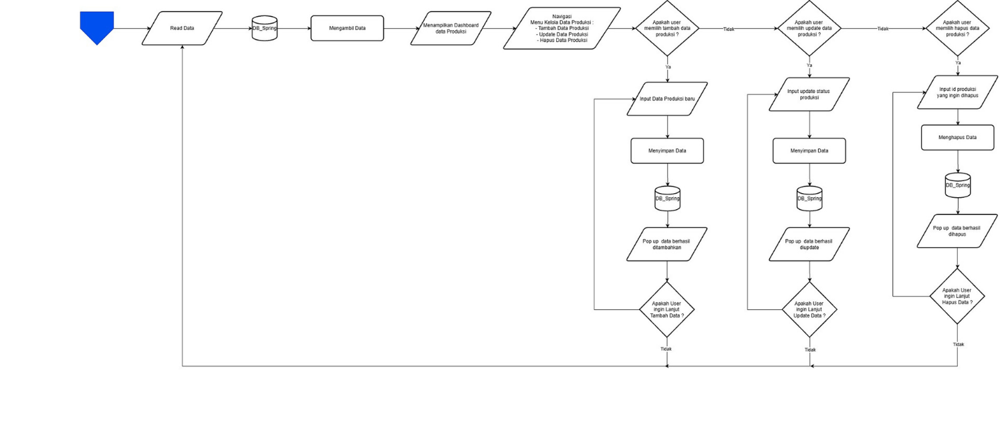
</p>

Flowchart ini menunjukkan proses membaca data produksi, menambahkan data baru, memperbarui data, dan menghapus data produksi melalui database.

</details>

<details>
<summary><b>🚚 5. Flowchart Pengelolaan Data Distribusi</b></summary>

<p align="center">
  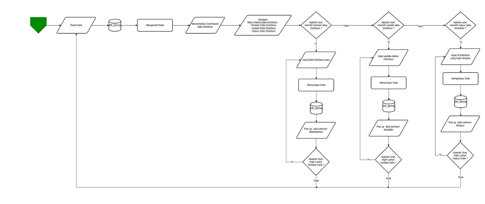
</p>

Flowchart ini menjelaskan proses pengelolaan transaksi distribusi, mulai dari menampilkan data, menambahkan transaksi, memperbarui status pengiriman, hingga menghapus data.

</details>

<details>
<summary><b>🏪 6. Flowchart Pengelolaan Data Agen</b></summary>

<p align="center">
  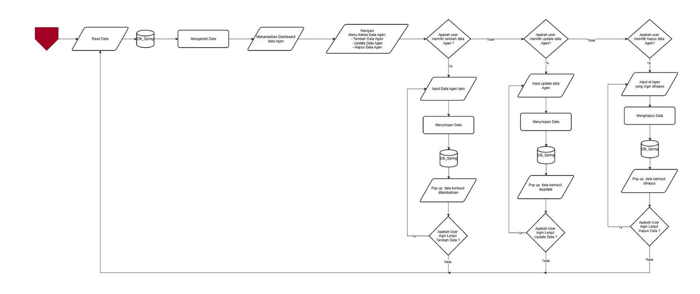
</p>

Flowchart ini menggambarkan proses pengelolaan data agen yang mencakup penambahan, perubahan, penghapusan, dan penampilan data agen.

</details>

<details>
<summary><b>📦 7. Flowchart Pengelolaan Data Produk</b></summary>

<p align="center">
  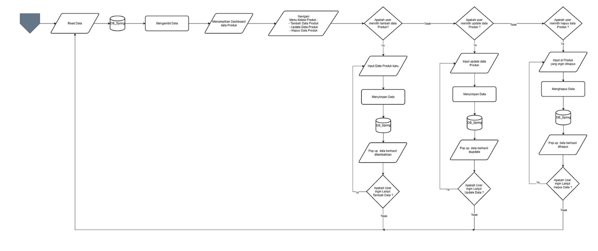
</p>

Flowchart ini menunjukkan proses pengelolaan informasi produk, termasuk penambahan, pembaruan, dan penghapusan data produk.

</details>

<details>
<summary><b>👤 8. Flowchart Pengelolaan Data Akun</b></summary>

<p align="center">
  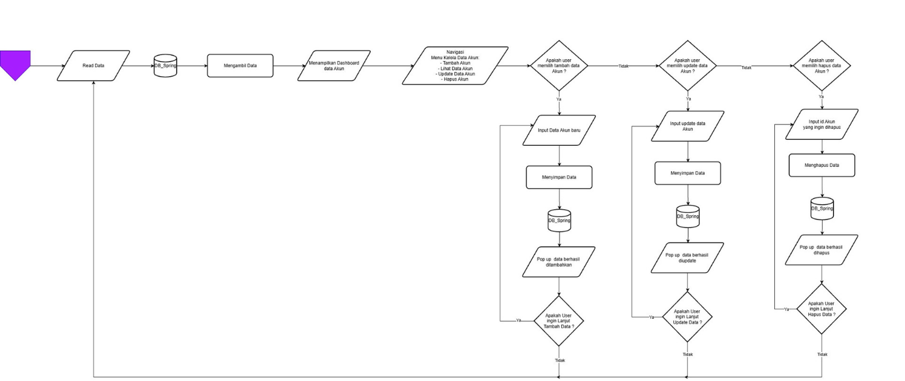
</p>

Flowchart ini menjelaskan proses pengelolaan akun pengguna oleh Admin, meliputi penambahan akun, pembaruan informasi akun, dan penghapusan akun.

</details>

**Link Flowchart:** [Buka rancangan Flowchart di diagrams.net](https://app.diagrams.net/#G1Gtvx8eD_4aQhSp9GlJ-w1HEe6iSGa7NL#%7B%22pageId%22%3A%220hWLyNMKS5f9EZlWx9hL%22%7D)

---

# 📋 USE CASE DIAGRAM

Use Case Diagram menggambarkan hubungan antara aktor dan fungsi yang tersedia dalam Sistem Informasi Manajemen Produksi dan Distribusi AMDK Spring.

<p align="center">
  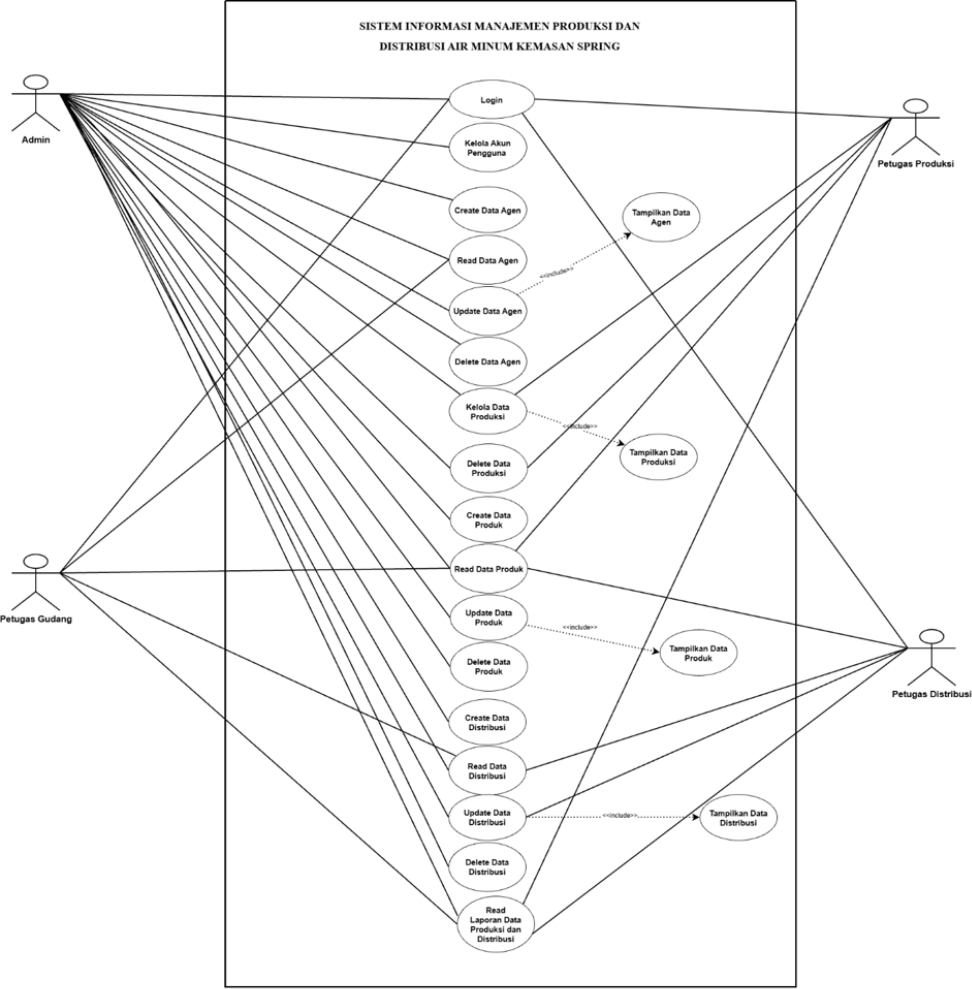
</p>

### Aktor dan Hak Akses

Sistem memiliki empat aktor utama:

1. **Admin:** Mengelola akun pengguna dan seluruh data utama sistem.
2. **Petugas Produksi:** Mengelola data kegiatan produksi dan melihat laporan.
3. **Petugas Gudang:** Melihat data agen, produksi, distribusi, memperbarui data produk, dan melihat laporan.
4. **Petugas Distribusi:** Melihat data produk dan distribusi, memperbarui status distribusi, serta melihat laporan.

### Tabel Hak Akses Pengguna

| Fitur | Admin | Produksi | Gudang | Distribusi |
|---|:---:|:---:|:---:|:---:|
| Login | ✓ | ✓ | ✓ | ✓ |
| Kelola Akun | CRUD | - | - | - |
| Data Agen | CRUD | - | R | - |
| Data Produksi | CRUD | CRUD | R | - |
| Data Produk | CRUD | - | U | R |
| Data Distribusi | CRUD | - | R | R/U |
| Laporan Produksi dan Distribusi | R | R | R | R |

**Keterangan:**
- C = Create
- R = Read
- U = Update
- D = Delete
- CRUD = Create, Read, Update, Delete

Hak akses disesuaikan dengan pembagian tugas pada Use Case Diagram dan Flowchart sistem.

---

# 🗄️ ARSITEKTUR DATABASE

Database Project SPRING dirancang menggunakan model relasional. Setiap entitas memiliki atribut dan hubungan yang saling terintegrasi melalui Primary Key (PK) dan Foreign Key (FK).

## 1. Logical ERD

Logical ERD menggambarkan entitas, atribut, dan hubungan antarentitas sebelum diterapkan ke dalam struktur tabel database.

<p align="center">
  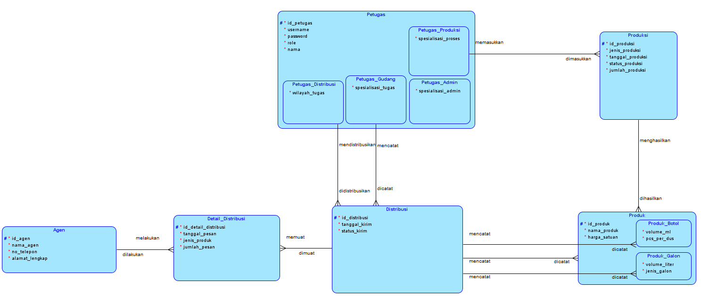
</p>

## 2. Relational ERD

Relational ERD menggambarkan implementasi rancangan database ke dalam tabel relasional yang dilengkapi Primary Key dan Foreign Key.

<p align="center">
  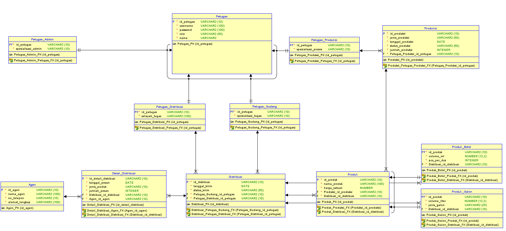
</p>

## 3. Penjelasan Entitas Database

| Entitas | Fungsi |
|---|---|
| Petugas | Menyimpan informasi akun dan identitas pengguna |
| Petugas_Admin | Menyimpan spesialisasi petugas admin |
| Petugas_Produksi | Menyimpan spesialisasi petugas produksi |
| Petugas_Gudang | Menyimpan spesialisasi petugas gudang |
| Petugas_Distribusi | Menyimpan spesialisasi petugas distribusi |
| Produksi | Menyimpan aktivitas produksi |
| Produk | Menyimpan informasi umum produk |
| Produk_Botol | Menyimpan atribut khusus produk botol |
| Produk_Galon | Menyimpan atribut khusus produk galon |
| Distribusi | Menyimpan informasi transaksi pengiriman |
| Detail_Distribusi | Menyimpan rincian pesanan distribusi |
| Agen | Menyimpan informasi agen perusahaan |

### Relasi Antarentitas

- Petugas Produksi berhubungan dengan Produksi.
- Produksi berhubungan dengan Produk yang dihasilkan.
- Petugas Gudang berhubungan dengan pencatatan Distribusi.
- Petugas Distribusi berhubungan dengan aktivitas Distribusi.
- Distribusi berhubungan dengan Detail Distribusi.
- Agen berhubungan dengan Detail Distribusi.
- Produk memiliki subtype Produk Botol dan Produk Galon.

---

# 🧩 PENERAPAN 4 PILAR OOP

Project SPRING menerapkan empat pilar utama Object-Oriented Programming (OOP), yaitu Encapsulation, Inheritance, Abstraction, dan Polymorphism.

## 1. Encapsulation (Enkapsulasi)

Enkapsulasi diterapkan dengan menggunakan access modifier `private` untuk melindungi atribut class dari akses langsung. Pengambilan dan perubahan nilai atribut dilakukan melalui method getter dan setter.

**Bukti kode: `Petugas.java`**

<p align="center">
  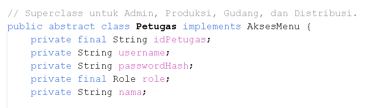
</p>

<p align="center">
  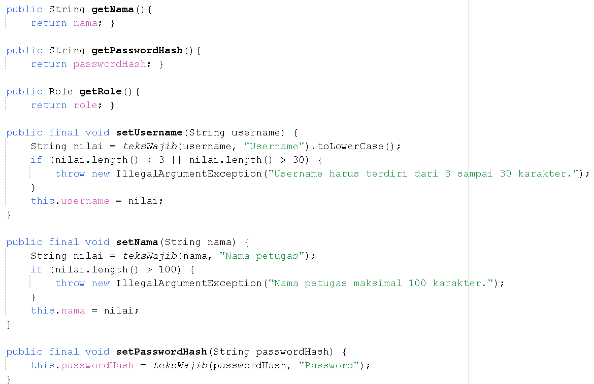
</p>

Pada class Petugas, atribut seperti `idPetugas`, `username`, `passwordHash`, `role`, dan `nama` menggunakan modifier private.

Selain itu, setter dilengkapi validasi untuk memastikan data yang dimasukkan memenuhi ketentuan, seperti panjang username dan nama petugas.

Penerapan ini membantu menjaga keamanan serta konsistensi data dalam objek.

## 2. Inheritance (Pewarisan)

Inheritance diterapkan dengan menggunakan class induk yang diwariskan kepada class turunannya.

**Bukti kode: `Petugas.java` dan `PetugasAdmin.java`**

<p align="center">
  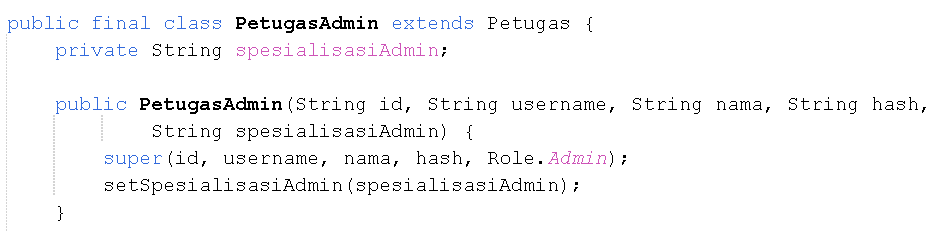
</p>

Class `Petugas` menjadi superclass yang menyimpan atribut dan perilaku umum seluruh petugas.

Class `PetugasAdmin` merupakan subclass yang menggunakan keyword `extends Petugas`.

Konstruktor menggunakan `super()` untuk memanggil konstruktor superclass dan menginisialisasi atribut umum petugas.

Konsep pewarisan yang sama diterapkan pada PetugasProduksi, PetugasGudang, dan PetugasDistribusi.

## 3. Abstraction (Abstraksi)

Abstraksi diterapkan menggunakan abstract class dan interface untuk menentukan struktur serta fungsi yang harus dimiliki oleh class lain.

### a. Abstract Class Produk

<p align="center">
  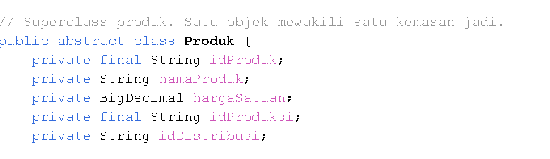
</p>

Class `Produk` menjadi superclass abstrak yang menyimpan atribut umum produk, seperti ID produk, nama produk, harga satuan, ID produksi, dan ID distribusi.

### b. Abstract Methods

<p align="center">
  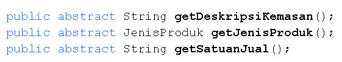
</p>

Class Produk mendefinisikan tiga method abstrak:

- `getDeskripsiKemasan()`
- `getJenisProduk()`
- `getSatuanJual()`

Method tersebut harus diimplementasikan oleh class turunannya sesuai karakteristik produk.

### c. Interface CrudDAO

<p align="center">
  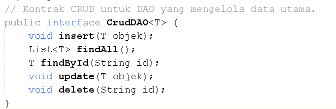
</p>

Interface `CrudDAO<T>` mendefinisikan kontrak pengelolaan data yang mencakup insert, findAll, findById, update, dan delete.

Penerapan abstraksi membantu memisahkan definisi fungsi dari implementasi operasionalnya.

## 4. Polymorphism (Polimorfisme)

Polimorfisme memungkinkan penggunaan nama method yang sama dengan perilaku berbeda. Project SPRING menerapkannya melalui Method Overriding dan Method Overloading.

### a. Method Overriding

**ProdukBotol.java**

<p align="center">
  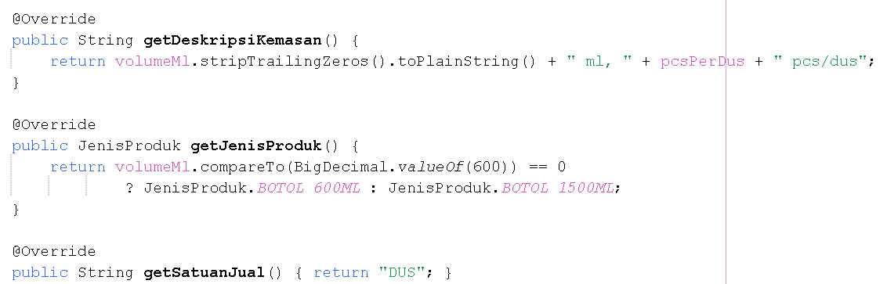
</p>

Class `ProdukBotol` mengimplementasikan kembali method abstrak dari class Produk.

Method `getDeskripsiKemasan()` menampilkan volume dalam mililiter dan jumlah produk per dus. Method `getJenisProduk()` menentukan jenis produk botol berdasarkan volumenya. Sementara itu, `getSatuanJual()` mengembalikan satuan DUS.

**ProdukGalon.java**

<p align="center">
  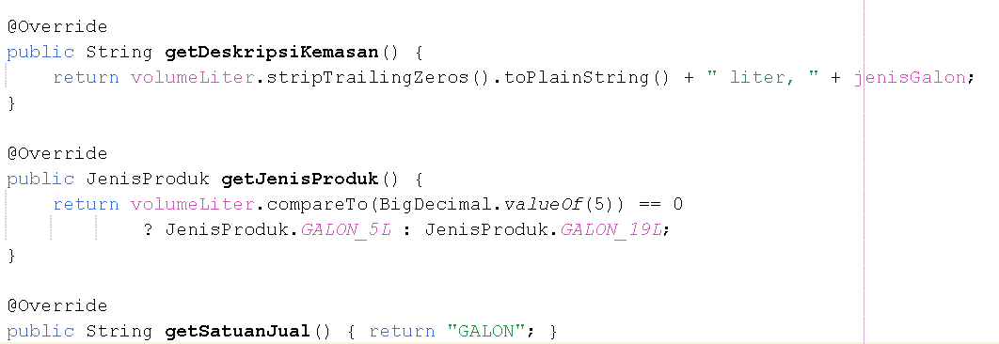
</p>

Class `ProdukGalon` mengimplementasikan method yang sama dengan karakteristik berbeda.

Method `getDeskripsiKemasan()` menampilkan volume dalam liter dan jenis galon. Method `getJenisProduk()` menentukan kategori galon berdasarkan volumenya. Method `getSatuanJual()` mengembalikan satuan GALON.

### b. Method Overloading

**AgenController.java**

<p align="center">
  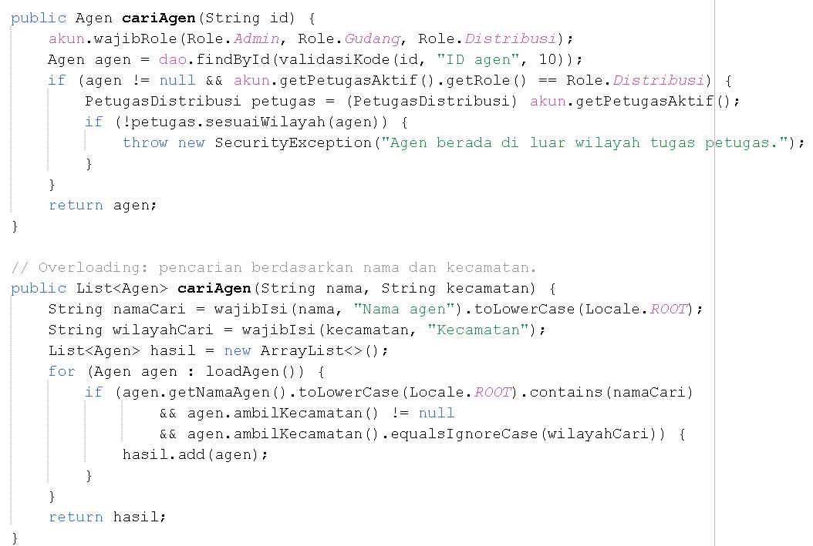
</p>

Method `cariAgen()` memiliki dua bentuk penggunaan dengan parameter berbeda:

1. `cariAgen(String id)` untuk mencari agen berdasarkan ID.
2. `cariAgen(String nama, String kecamatan)` untuk mencari agen berdasarkan nama dan kecamatan.

Penerapan overloading membuat proses pencarian agen lebih fleksibel.

---

# 🏗️ STRUKTUR PACKAGE PROGRAM

Project SPRING menggunakan pemisahan package berdasarkan fungsi dan tanggung jawab setiap class.

### Struktur Folder

```text
spring/
├── pom.xml
└── src/
    └── main/
        ├── java/
        │   ├── config/
        │   │   └── DatabaseConnection.java
        │   ├── controller/
        │   │   ├── AgenController.java
        │   │   ├── AkunController.java
        │   │   ├── DistribusiController.java
        │   │   ├── LaporanController.java
        │   │   ├── ProdukController.java
        │   │   ├── ProduksiController.java
        │   │   ├── SistemController.java
        │   │   └── ValidasiInput.java
        │   ├── dao/
        │   │   ├── CrudDAO.java
        │   │   ├── AgenDAO.java
        │   │   ├── AgenJdbcDAO.java
        │   │   ├── DetailDistribusiDAO.java
        │   │   ├── DistribusiDAO.java
        │   │   ├── DistribusiJdbcDAO.java
        │   │   ├── LaporanDAO.java
        │   │   ├── LaporanJdbcDAO.java
        │   │   ├── PetugasDAO.java
        │   │   ├── PetugasJdbcDAO.java
        │   │   ├── ProdukDAO.java
        │   │   ├── ProdukJdbcDAO.java
        │   │   ├── ProduksiDAO.java
        │   │   └── ProduksiJdbcDAO.java
        │   ├── main/
        │   │   └── MainApp.java
        │   ├── model/
        │   │   ├── Agen.java
        │   │   ├── AksesMenu.java
        │   │   ├── DetailDistribusi.java
        │   │   ├── Distribusi.java
        │   │   ├── Petugas.java
        │   │   ├── PetugasAdmin.java
        │   │   ├── PetugasDistribusi.java
        │   │   ├── PetugasGudang.java
        │   │   ├── PetugasProduksi.java
        │   │   ├── Produk.java
        │   │   ├── ProdukBotol.java
        │   │   ├── ProdukGalon.java
        │   │   ├── Produksi.java
        │   │   └── type/
        │   │       ├── JenisProduk.java
        │   │       ├── Role.java
        │   │       ├── StatusKirim.java
        │   │       └── StatusProduksi.java
        │   └── view/
        │       ├── Form Java Swing
        │       ├── ViewHelper.java
        │       └── panel/
        │           ├── AgenPanel.java
        │           ├── AkunPanel.java
        │           ├── DistribusiPanel.java
        │           ├── LaporanPanel.java
        │           ├── ProdukPanel.java
        │           ├── ProduksiPanel.java
        │           └── StokPanel.java
        └── resources/
            └── images/
                ├── Spring Logo with Swirl Emblem.png
                ├── Spring Logo with Swirl Emblem (2).png
                └── pabrik 2.png
```

### Penjelasan Package

| Package | Fungsi |
|---|---|
| `config` | Mengatur konfigurasi dan koneksi database MySQL. |
| `controller` | Mengatur logika bisnis, validasi, dan proses setiap fitur. |
| `dao` | Mengelola operasi akses data melalui interface DAO dan implementasi JDBC. |
| `main` | Menyediakan class utama untuk menjalankan aplikasi. |
| `model` | Menyimpan representasi objek dan entitas sistem. |
| `model.type` | Menyimpan enum untuk role, jenis produk, dan status operasional. |
| `view` | Menyediakan tampilan aplikasi berbasis Java Swing. |
| `view.panel` | Mengelompokkan panel berdasarkan fitur aplikasi. |
| `resources/images` | Menyimpan gambar dan aset visual aplikasi. |

### Alur Hubungan Antar-Package

Secara umum, interaksi antarbagian program berjalan sebagai berikut:

1. Pengguna melakukan interaksi melalui package `view`.
2. Permintaan diteruskan ke package `controller`.
3. Controller menjalankan logika bisnis dan validasi.
4. Pengelolaan data dilakukan melalui package `dao`.
5. DAO berkomunikasi dengan database menggunakan JDBC.
6. Data direpresentasikan melalui class pada package `model`.
7. Hasil proses dikembalikan ke tampilan aplikasi.

Pemisahan package tersebut membuat program lebih terstruktur dan memudahkan pengembangan maupun pemeliharaan sistem.

---

# 🗃️ DATABASE PROJECT

Database utama yang digunakan adalah:

**`db_amdk_spring`**

Database ini menyimpan informasi operasional perusahaan, termasuk data petugas, agen, produk, produksi, distribusi, dan detail distribusi.

Koneksi database dikelola melalui class `DatabaseConnection.java` dengan memanfaatkan JDBC dan MySQL Connector/J.

File SQL database dapat diakses melalui tautan berikut:

📄 **[Download db_amdk_spring.sql](./db_amdk_spring.sql)**

---

<p align="center">
  <b>💧 PROJECT SPRING</b><br>
  Sistem Informasi Manajemen Produksi dan Distribusi Air Minum Kemasan<br>
  Program Studi Sistem Informasi · Fakultas Teknik<br>
  Universitas Mulawarman · 2026
</p>
